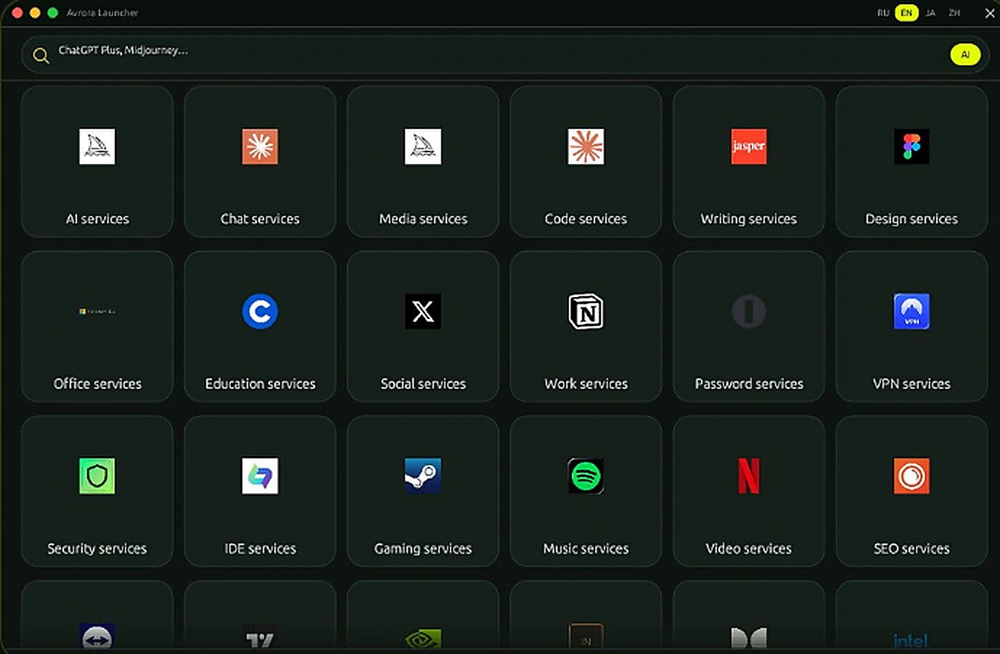

# Hulu No Ads Free 2026 — next-day TV, Originals, no ads

> **Hulu is paid everywhere. In our Aivora launcher the same paid No Ads version is free.**
>
> Official site / app store = paid No Ads subscription. Aivora launcher = that paid No Ads product, free on Windows 10 / 11.

**Keywords:** Hulu No Ads · Hulu free · Hulu windows · next-day TV · Hulu Originals · paid Hulu free through launcher · Aivora Programs

Windows 10 / 11 · Hulu No Ads · Video streaming

The orange button opens [https://aivoraprograms.com/](https://aivoraprograms.com/). Install Aivora, then **Activate** **Hulu**. You get the **paid No Ads** product **for free in our launcher**. No `Hulu.exe` in this repository.

## What Hulu is

Hulu No Ads is the paid TV SKU: **next-day network TV**, **Hulu Originals**, **no ads**, offline on mobile, Live TV add-on ready. The Aivora card is **No Ads**, not the ads plan. This is not Disney+ Premium and not Max Ad-Free.

**Hulu is paid everywhere else.** Official access is a No Ads subscription. In **our Aivora launcher** that same paid No Ads is **free** on Windows 10 / 11. No vendor account. No credit card.

## next-day TV, Originals, no ads

Next-day TV is the US network extra. Originals are the Hulu-only extra. After **Activate**, open Hulu from video streaming. This repo has no episode file.

## Who this Windows page is for

Searches **Hulu**, **Hulu No Ads**, **Hulu windows** wanting **paid No Ads**.

## What the No Ads card includes

| Feature | Official Hulu | In our Aivora launcher |
|---------|--------------|------------------------|
| Price | Paid No Ads subscription | **Free** (same paid No Ads) |
| **Next-day TV** | No Ads | Same paid No Ads, free here |
| **Hulu Originals** | No Ads | Same paid No Ads, free here |
| **No ads** | No Ads | Same paid No Ads, free here |

## How to open paid Hulu on Windows

1. Open [https://aivoraprograms.com/](https://aivoraprograms.com/)
2. Download **Aivora Launcher**
3. Install on **Windows 10** or **Windows 11** (64-bit)
4. Open **Video streaming**
5. Find **Hulu** and press **Activate**

Paid Hulu No Ads — **free in our launcher**, paid on the official site.

## Search queries this page covers

- **Hulu No Ads**
- **Hulu free**
- **Hulu windows**
- **next-day TV**
- **paid Hulu free through launcher**

## Screenshots

Aivora launcher hub — **Video streaming** → **Hulu**:

## FAQ

**Is this Disney+?**  
No. Disney+ Premium is a different Aivora card. This tile is Hulu No Ads.

**Where is the download?**  
[https://aivoraprograms.com/](https://aivoraprograms.com/)

**Is Hulu paid or free?**  
Paid everywhere (official No Ads). **Free in our Aivora launcher** — same paid No Ads version.

**Do I need a Hulu account?**  
No. **Activate** on the tile.

---

## На русском

# Hulu No Ads бесплатно 2026 — сериалы на следующий день, Originals, без рекламы

> **Везде Hulu платный. В нашем лаунчере Aivora та же платная версия No Ads — бесплатно.**
>
> Официальный сайт / магазин = платная подписка No Ads. Лаунчер Aivora = этот же платный No Ads, бесплатно на Windows 10 / 11.

**Ключевые слова:** Hulu No Ads · Hulu бесплатно · Hulu windows · сериалы на следующий день · Hulu Originals · платный Hulu бесплатно через лаунчер · Aivora Programs

Оранжевая кнопка — главная Aivora. Лаунчер → **Стриминг видео** → **Hulu** → **Активировать**. Это **платный No Ads**, у нас в лаунчере **бесплатно**.

Hulu No Ads — платное ТВ: **сериалы на следующий день**, **Hulu Originals**, **без рекламы**, офлайн, готов Live TV. Карточка Aivora — **No Ads**, не тариф с рекламой. Это не Disney+ и не Max.

**Hulu везде платный.** Официально подписка No Ads. **В нашем лаунчере Aivora** та же платная No Ads-версия — **бесплатно** на Windows 10 / 11.

Next-day — эфир США на следующий день. Originals — только Hulu. Серий в git нет.

Запросы **Hulu**, **Hulu бесплатно** — нужен **платный No Ads**.

| Функция | Официально | В нашем лаунчере Aivora |
|---------|------------|-------------------------|
| Цена | Платная подписка No Ads | **Бесплатно** (тот же No Ads) |
| **Сериалы на следующий день** | No Ads | Та же платная No Ads, у нас бесплатно |
| **Hulu Originals** | No Ads | Та же платная No Ads, у нас бесплатно |
| **Без рекламы** | No Ads | Та же платная No Ads, у нас бесплатно |

Как открыть: [https://aivoraprograms.com/](https://aivoraprograms.com/) → лаунчер → **Стриминг видео** → **Hulu** → **Активировать**.

**Это Disney+?**  
Нет. Disney+ — другая карточка. Здесь Hulu No Ads.

Hulu — товарный знак Hulu, LLC. Страница описывает доступ через Aivora Programs.

[https://aivoraprograms.com](https://aivoraprograms.com/) · hello@aivora.app

#windows11 #windows10 #hulu #streaming #aivora

---

*Hulu No Ads · Hulu free · Hulu windows · next-day TV · Hulu Originals · paid Hulu free through launcher · Aivora Programs · paid Hulu free through launcher · Aivora Programs · https://aivoraprograms.com/programs/hulu-no-ads/*
